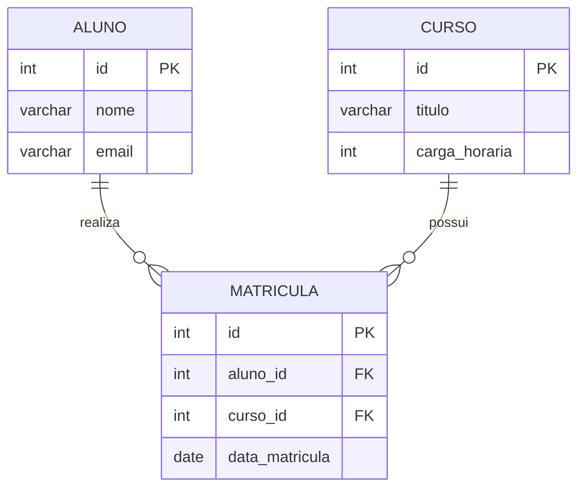

<div align="center">


<a href="https://git.io/typing-svg">
  
</a>

<br>


</div>

<br>

> [!NOTE]
> Este repositório é o meu **caderno digital de Banco de Dados**: cada pasta guarda uma etapa do caminho, do desenho no papel até o relatório com `JOIN`.

---

## 🧾 Ficha Técnica

| | |
|---|---|
| 🎓 **Curso** | Técnico em Desenvolvimento de Sistemas |
| 👨‍🏫 **Orientador** | Prof. Caio Malheiros |
| 🛠️ **Ferramentas** | brModelo (modelo Conceitual e Lógico) e MySQL (modelo Físico e scripts) |
| 🎯 **Objetivo** | Documentar práticas de modelagem e manipulação de dados |

<div align="center">


</div>

---

## 🧭 Trilha de Aprendizado

```text
Progresso geral   ████████░░░░░░░░   50%   (2 de 4 atividades)
```

| # | Atividade | Ferramenta | Status |
|:-:|-----------|:----------:|:------:|
| 01 | Modelagem Conceitual e Lógica | brModelo | ✅ Concluída |
| 02 | Criação de Tabelas e Relacionamentos | MySQL | ✅ Concluída |
| 03 | Inserção de Dados e Consultas Simples | MySQL | ⏳ Em breve |
| 04 | Relatórios com JOINs | MySQL | ⏳ Em breve |

---

## 🧩 Exemplo de Modelo Entidade-Relacionamento

Um DER simples, no mesmo estilo dos diagramas que desenho no brModelo:



---

## 📚 Guia Rápido: o que cada sigla faz

| Sigla | Significa | Serve para | Comandos principais |
|:-----:|-----------|------------|---------------------|
| **DDL** | Data Definition Language | Criar e alterar a **estrutura** | `CREATE` · `ALTER` · `DROP` |
| **DML** | Data Manipulation Language | Mexer nos **registros** | `INSERT` · `UPDATE` · `DELETE` |
| **DQL** | Data Query Language | **Consultar** e gerar relatórios | `SELECT` · `WHERE` · `JOIN` · `GROUP BY` |

<details>
<summary>👀 Ver um exemplo de cada um</summary>

```sql
-- DDL: cria a estrutura
CREATE TABLE aluno (
    id    INT AUTO_INCREMENT PRIMARY KEY,
    nome  VARCHAR(100) NOT NULL,
    email VARCHAR(120) UNIQUE
);

-- DML: insere um registro
INSERT INTO aluno (nome, email)
VALUES ('Maria Souza', 'maria@email.com');

-- DQL: consulta os dados
SELECT nome, email
FROM aluno
ORDER BY nome;
```

</details>

> [!TIP]
> Rode os scripts sempre na ordem **DDL → DML → DQL**. As consultas dependem de tabelas e dados que já existam.

---

## 🗂️ Estrutura do Repositório

```text
Banco-de-Dados/
├── 📐 01-modelagem/      → arquivos .brM3 e imagens dos diagramas
├── 🏗️ 02-ddl/            → scripts de criação e alteração de tabelas
├── ✏️ 03-dml/            → scripts de INSERT, UPDATE e DELETE
├── 🔍 04-dql/            → consultas e relatórios
└── 🖼️ assets/            → imagens usadas neste README
```

---

## ▶️ Como Executar

```bash
# clonar o repositório
git clone https://github.com/SEU-USUARIO/Banco-de-Dados.git
cd Banco-de-Dados

# executar um script no MySQL
mysql -u root -p < 02-ddl/criar_tabelas.sql
```

---

<div align="center">

*Commit após commit, construindo a base de dados.* 🚀

</div>


